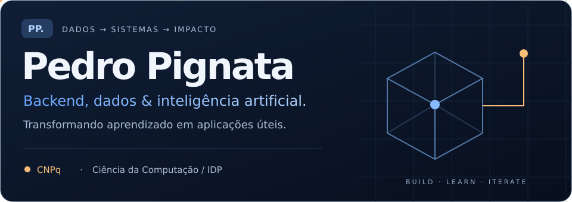
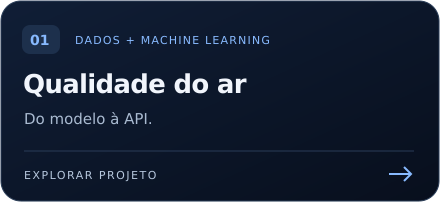
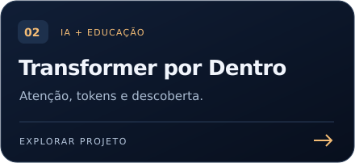
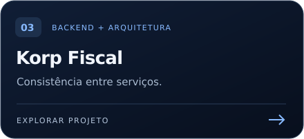
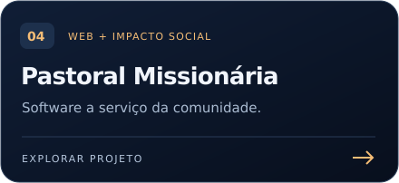

  

  
  

  <a href="#sobre-mim">Sobre mim</a> ·
  <a href="#projetos-em-destaque">Projetos</a> ·
  <a href="#tecnologias">Tecnologias</a> ·
  <a href="#vamos-conversar">Contato</a>

## Sobre mim

Sou **Pedro Pignata**, estudante de **Ciência da Computação no IDP** e **estagiário no CNPq**. Meu foco é conectar dados, modelos e APIs para criar aplicações que outras pessoas possam usar.

Comecei com Python em projetos acadêmicos de análise de dados e levei essa experiência ao desenvolvimento de backend. Gosto de entender o caminho completo, da exploração dos dados à integração com uma aplicação.

| Agora | Experiência em equipe | Empreendedorismo |
| :--- | :--- | :--- |
| **CNPq** Análise exploratória de dados e estudo de aplicações de LLMs. | **LegixTech** Backend de um aplicativo de acompanhamento legislativo, em colaboração com a equipe mobile. | **Pignata’s Print** Negócio de impressão 3D sob demanda, com atuação na produção e no atendimento. |

## Projetos em destaque

Uma seleção de trabalhos em **IA aplicada, backend e sistemas web**. Cada cartão leva ao código e à documentação.

<table>
<tr>
<td width="50%" valign="top">

**Previsão de monóxido de carbono** com Random Forest integrado a uma API HTTP e executável com Docker Compose. **R² de 0,85** no conjunto de teste.

`Python` `Flask` `scikit-learn` `Docker`

[Ver código e execução →](https://github.com/PedroPignata/idp-machinelearning/tree/main/AV01)

</td>
<td width="50%" valign="top">

**Simulador educacional interativo** que mostra como um Transformer simplificado processa tokens, calcula atenção e gera uma sequência de saída.

`Python` `Streamlit` `Transformers`

[Conhecer o simulador →](https://github.com/PedroPignata/Compiladores/tree/main/transformer-simulator)

</td>
</tr>
<tr>
<td width="50%" valign="top">

**Emissão de notas fiscais com microsserviços**, bancos separados e baixa de estoque idempotente, com tratamento de falhas e concorrência.

`C#` `ASP.NET Core` `PostgreSQL` `Angular`

[Explorar a arquitetura →](https://github.com/PedroPignata/Korp_Teste_PedroPignata)

</td>
<td width="50%" valign="top">

**Gestão de pedidos, pagamentos e entregas** com persistência em SQLite, relatórios e sincronização com o Google Planilhas.

`TypeScript` `Express` `SQLite` `Google Planilhas`

[Conhecer o sistema →](https://github.com/PedroPignata/pastoral-missionaria)

</td>
</tr>
</table>

### Colaboração · LegixTech

No **[LegixTech](https://github.com/idp-edu/LegixTech/tree/main/backend)**, trabalhei com a equipe no backend de um app de acompanhamento legislativo, desenvolvendo funcionalidades com **FastAPI, PostgreSQL e Alembic** e colaborando na integração com o aplicativo mobile.

<b>Por dentro dos projetos — o que vale explorar</b>

- **Qualidade do ar** — fluxo entre dados de entrada, modelo treinado e endpoint `/predict`, com ambiente reproduzível em contêiner.
- **Transformer por Dentro** — visualização das etapas de uma arquitetura simplificada para apoiar o aprendizado de atenção e geração de texto.
- **Korp Fiscal** — fechamento de notas, comunicação entre serviços e idempotência para evitar baixas duplicadas de estoque.
- **Pastoral Missionária** — controle financeiro e de entregas, exportação de relatórios e sincronização por fila outbox transacional.

## Tecnologias

  
  
  
  

| Área | Tecnologias e temas |
| :--- | :--- |
| **Backend e APIs** | Python · FastAPI · Flask · C# · ASP.NET Core · Java |
| **Dados e machine learning** | Pandas · scikit-learn · análise exploratória · modelos preditivos |
| **Persistência e infraestrutura** | PostgreSQL · SQLite · Alembic · Docker |
| **Em estudo** | LLMs · arquitetura Transformer · integração de IA em aplicações |

## Vamos conversar

Para trocar ideias sobre **backend, dados, IA aplicada ou projetos**, me encontre no **[LinkedIn](https://www.linkedin.com/in/pedro-rafael-santos-pignata-02696a2b0/)**.

[Explorar todos os repositórios →](https://github.com/PedroPignata?tab=repositories)

  

